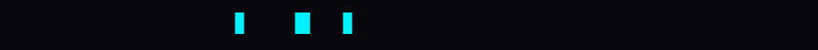

<div align="center">




</div>

```text
┌─[ identity ]───────────────────────────────────┐
│ name     Syed Zia Hasan                        │
│ role     Co-Founder                            │
│ org      The Technostics Group                 │
│ status   building and learning                 │
└────────────────────────────────────────────────┘
```



## About

I'm Syed Zia Hasan, co-founder of [The Technostics Group](https://technosticsgroup.com/), a cybersecurity-focused technology startup.

<!-- EDIT ME: add one or two sentences on what you personally build or own at the company. -->

## What I'm working on

- [**ttg-cardputer-business-card**](https://github.com/syedziahasan2112-coder/ttg-cardputer-business-card): a business-card project for the M5Stack Cardputer, written in C++. Forked from the original by my co-founder [@jker24256-max](https://github.com/jker24256-max).

<!-- EDIT ME: add more projects here, one bullet each, as you ship them. -->

## Stack


<!-- EDIT ME: add a badge for each language or tool you actually use: https://shields.io -->

## Connect

[](https://technosticsgroup.com/)
[](https://github.com/jker24256-max)
<!-- EDIT ME: add your LinkedIn the same way, e.g.
[](https://www.linkedin.com/in/YOUR-HANDLE)
-->



